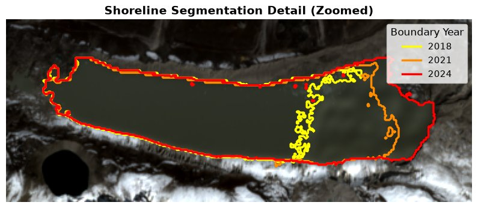
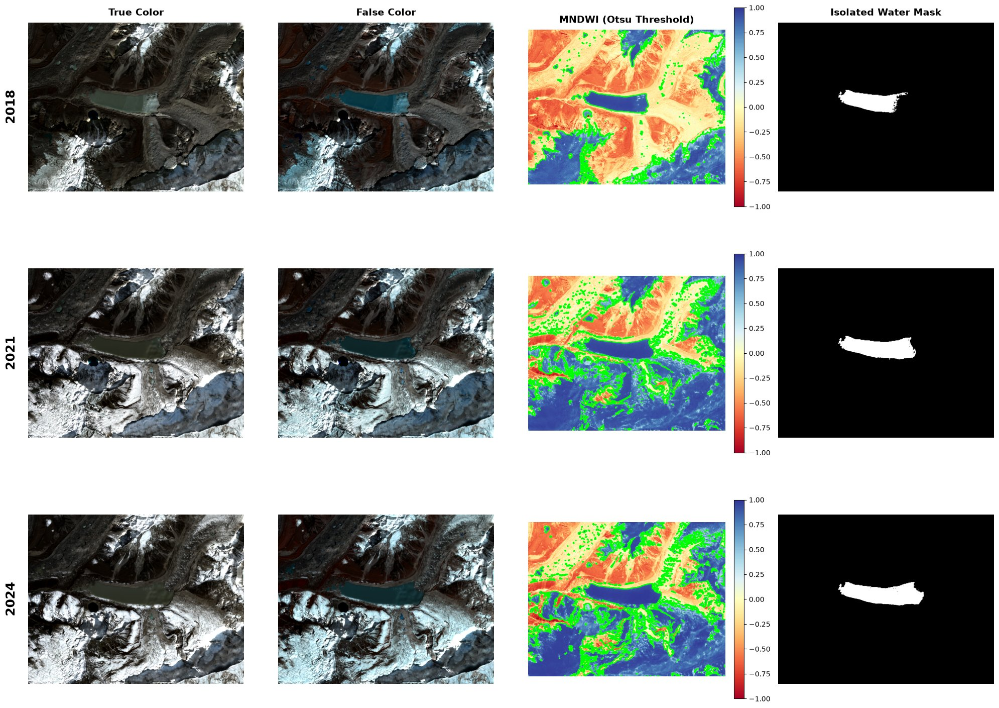

# Imja Tsho Lake Expansion

[](https://github.com/piotr-lorek/Imja-Tsho-Lake-Expansion/actions/workflows/ci.yml)

Measuring the growth of Imja Tsho, a glacial lake in the Nepal Himalaya, from Sentinel-2 satellite imagery (2018–2024).



Imja Tsho sits behind a moraine dam at the snout of the retreating Imja Glacier in Sagarmatha National Park. As the glacier retreats, the lake grows, and so does the volume of water a Glacial Lake Outburst Flood (GLOF) could release. This project detects the lake automatically on three dates and measures how its open-water area changed.

## Results

| Date | Open-water area | Change since previous date |
| --- | --- | --- |
| 30 Oct 2018 | 1.179 ± 0.118 km² | |
| 8 Nov 2021 | 1.571 ± 0.098 km² | +0.393 ± 0.154 km² (+33.4%) |
| 13 Oct 2024 | 1.792 ± 0.104 km² | +0.221 ± 0.143 km² (+14.0%) |

Changes are computed from the unrounded areas, and their uncertainties combine both dates' in quadrature. The uncertainties are a conservative bound on shoreline error only; see [Limitations](#limitations).

- **Open water grew by 0.614 km² (+52%) between 2018 and 2024**, about 7.3% per year.
- **Much of that is ice clearing, not lake growth.** In 2018 the eastern end of the lake was ice-covered, which is correctly excluded as not open water. About 0.28 km² of 2018 ice became open water later, roughly 70% of the 2018–2021 increase. Counting it, the lake itself grew by about **+23% (3.6% per year)** over 2018–2024. The 2021–2024 interval, with much less ice, gives **+14% (4.6% per year)**.
- **Nearly all of the change is at the eastern, glacier end.** The outlet at the moraine-dammed western end did not move, over 90% of the gained area lies in the eastern half, and the eastern shore advanced about 300 m in each three-year interval.

The full analysis, including validation and limitations, is in the [notebook](notebooks/imja_tsho_analysis.ipynb).

## Method



1. **Surface reflectance.** Sentinel-2 L2A bands B02, B03, B04, B08 and B11 on a common 10 m grid.
2. **Water index.** MNDWI, `(green − SWIR) / (green + SWIR)`, separates the sediment-laden lake from land much better than the standard NDWI.
3. **Automatic threshold.** Otsu's method finds the valley in each date's bimodal MNDWI histogram.
4. **Snow and ice rejection.** MNDWI uses the same formula as the snow index NDSI, so snow scores as high as water. Pixels with near-infrared (B08) reflectance of 0.20 or more are rejected: water absorbs NIR, snow and ice reflect it. A further `NDWI > 0` test removes a few hundred scattered pixels per date, with almost no effect on the lake.
5. **Lake isolation.** Connected-component labelling keeps the largest contiguous water body, and its area is the pixel count × 100 m².
6. **Validation.** Over 96% of each earlier outline lies inside the later one, no lake fragments were discarded, and the boundary uncertainty counts one pixel per vertex of the lake outline. The notebook also tests how the results depend on the NIR ceiling and the Otsu threshold.

## Quick start

Requires [uv](https://docs.astral.sh/uv/).

```bash
git clone https://github.com/piotr-lorek/Imja-Tsho-Lake-Expansion.git
cd Imja-Tsho-Lake-Expansion
uv sync
```

Download the imagery (~11 MB). This needs free Copernicus Data Space credentials; see [data/README.md](data/README.md):

```bash
export CDSE_CLIENT_ID=...
export CDSE_CLIENT_SECRET=...
uv run python scripts/download_data.py
```

On Windows (PowerShell), set the credentials with `$env:CDSE_CLIENT_ID = "..."` and `$env:CDSE_CLIENT_SECRET = "..."` instead.

Run the analysis. This prints the results and writes all figures to `figures/` and a table to `results/lake_areas.csv`:

```bash
uv run python scripts/run_analysis.py
```

Both scripts accept `--data-dir` to use data stored elsewhere (`--help` lists all options). Or explore the analysis step by step in the notebook, which reads `data/` or the directory in the `GLACIAL_LAKE_DATA_DIR` environment variable:

```bash
uv run --with jupyterlab jupyter lab notebooks/imja_tsho_analysis.ipynb
```

## Development

```bash
uv run pytest                  # tests (synthetic data; a real-data check runs if data/ exists)
uv run ruff check .            # lint
uv run ruff format .           # format
```

After changing the pipeline, regenerate the outputs so the figures, results table and notebook stay in sync:

```bash
uv run python scripts/run_analysis.py
uv run jupyter nbconvert --to notebook --execute --inplace \
    --ClearMetadataPreprocessor.enabled=True notebooks/imja_tsho_analysis.ipynb
```

## Repository layout

```
├── .github/workflows/     # CI: ruff and pytest
├── data/                  # downloaded imagery (git-ignored); README with provenance
├── figures/               # figures generated by scripts/run_analysis.py
├── notebooks/
│   └── imja_tsho_analysis.ipynb
├── results/
│   └── lake_areas.csv     # per-date threshold, pixel counts, area and uncertainty
├── scripts/
│   ├── download_data.py   # fetch Sentinel-2 bands from Copernicus Data Space
│   └── run_analysis.py    # full pipeline: results table and all figures
├── src/glacial_lake/      # analysis package
│   ├── config.py          # area of interest, dates, bands
│   ├── io.py              # band loading and reflectance conversion
│   ├── indices.py         # NDWI and MNDWI
│   ├── segmentation.py    # water mask and connected components
│   ├── metrics.py         # area, shape, nesting and uncertainty
│   ├── pipeline.py        # detect_lake(): one scene end to end
│   └── plotting.py        # all figures
└── tests/                 # pytest suite on synthetic scenes
```

## Limitations

- The reported values are **open-water** area on each acquisition date. Seasonal lake ice, most visibly in 2018, lowers them below the full lake area. The ice-corrected 2018 area is an approximation.
- The 0.20 NIR ceiling is a single empirical value, and the results depend on it: between 0.15 and 0.25, the 2018–2024 growth in open water ranges from +38% to +55%. This matters more for the trend than the shoreline uncertainty. The per-date Otsu thresholds do not: one threshold pooled over all dates changes no area by more than 0.002 km².
- The 10 m resolution limits shoreline precision. The stated uncertainties are a deliberately conservative bound (one pixel per outline vertex, about 2.5 times the common half-pixel convention) and cover shoreline error only.

## Data and license

Contains modified Copernicus Sentinel data (2018, 2021, 2024), processed by the Copernicus Data Space Ecosystem. The code is released under the [MIT License](LICENSE).
